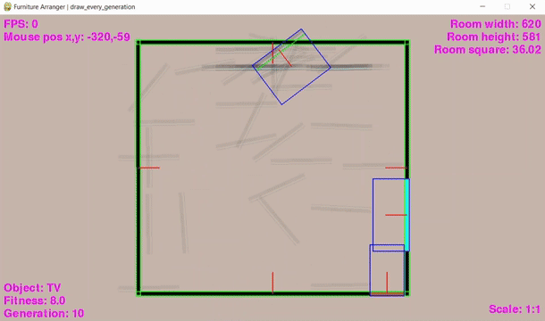
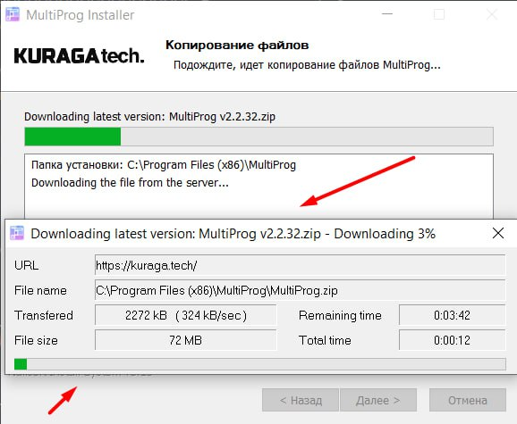

# Vladislav Fedorov (Software Engineer / R&D Developer)

🇷🇺 [Русский](README.ru.md) · 🇪🇳 **English**


**Telegram:** [@Barhatnoe_puzzo](https://t.me/Barhatnoe_puzzo) · **Email:** vladislav.fedorov.work@gmail.com

---

## 👨‍💻 About Me

I am an R&D Software Engineer focused on building complex, non-standard systems from the ground up. I am not tied to a particular technology stack: my work ranges from reverse-engineering binary protocols and controlling hardware over UDP/TCP - including Arduino-based thermostats deployed in the Far North - to developing custom 3D engines with OpenGL/GLSL and performing mathematical calculations of satellite orbits using GNSS data.

I enjoy working at the intersection of different technologies and have a strong interest in low-level mechanisms: memory internals, graphics pipelines, and concurrency. I go beyond application-level APIs and regularly investigate the layers beneath them - protocols, data formats, threads, memory, performance, and architecture. I adapt quickly to new technologies, am comfortable learning new programming languages, and enjoy collaborating with people from different backgrounds.

I am also interested in opportunities in game development, VR, computer vision, DeepTech, and advanced algorithmic engineering.

---

## 🎓 Education

**Belarusian National Technical University (BNTU)**  
*Software Engineer, Faculty of Information Technologies and Robotics (FITR), 2018–2022*

**Thesis:** Using Genetic Algorithms for 3D Product Design.

---

## 🛠 Technical Skills

- **Programming languages:** Python (Advanced), C++ (Intermediate), C, C#, Java, JavaScript, SQL, Lua, Assembly (reading and basic analysis).
- **Desktop development:** Qt/QML, Windows Forms, Tkinter.
- **3D graphics:** OpenGL (ModernGL), GLSL (custom shaders), 3D mathematics (vectors, matrices, quaternions), Level of Detail (LOD), Frustum Culling, Unity3D, Godot.
- **Algorithms and AI:** Genetic and evolutionary algorithms, graph theory (DFS/BFS, Dijkstra, A*), machine learning (scikit-learn), computer vision (OpenCV), neural networks.
- **Performance engineering:** Multithreading, race conditions, locks, asyncio, JIT compilation (Numba), NumPy, profiling.
- **Low-level development and hardware:** Binary data analysis, byte-level parsing, disassembly (Ghidra, IDA), network protocols (UDP/TCP), packet analysis (Wireshark), WinAPI, Arduino, ESP32/ESP8266, Raspberry Pi.
- **Build and distribution:** PyInstaller, NSIS, Windows executables, certificate signing, Windows Registry, URL schemes.
- **Automation:** Selenium, requests, Appium, Tasker, ADB, Power Automate, Telegram bots.
- **English:** B2 (strong listening comprehension; intermediate spoken fluency).

---

## 💼 Professional Experience

### Freelance / Independent R&D Software Engineer

*July 2022 – Present*

Delivered approximately 50 projects, more than 30 of which were complex, R&D-intensive B2B projects completed end to end — from architecture design to release.

## Selected Projects

### 1. Computer Graphics and 3D Engine Development

**EarthStream 3D Engine** *(Python, OpenGL 3.3 Core, GLSL, PyQt5, NumPy)*

Designed and developed a custom 3D engine for streaming and rendering real-world Earth topography from Digital Elevation Models (DEMs).

- **Architecture:** Built a multithreaded geodata-loading pipeline with strict separation between UI and rendering threads.
- **Optimization:** Implemented seamless in-memory geometry stitching to eliminate T-junctions, vectorized Frustum Culling, and dynamic LOD. The engine renders millions of polygons while maintaining a stable 60+ FPS.
- **Shaders and camera:** Developed terrain generation using Fractal Brownian Motion, distance fog, and a collision-aware first-person camera.
- **Developer tooling:** Built a separate developer toolset for adjusting rendering parameters without blocking the OpenGL context.

🎥 

<details>
<summary>Code sample: DEM tile stitching</summary>

```python
for chunk in self.active_chunks:
    cx, cz = chunk

    # Convert the byte buffer into a 3D NumPy array (256x256 pixels, 3 RGB channels).
    dem_bytes = self.chunk_textures[chunk]['dem'].read()
    dem_np = np.frombuffer(dem_bytes, dtype=np.uint8).reshape((256, 256, 3)).copy()

    # 1. Stitch the current tile to its left neighbour (cx-1).
    # Average the current tile's left edge (column 0) with the neighbour's right edge (column 255).
    if (cx - 1, cz) in self.dem_arrays:
        neigh = self.dem_arrays[(cx - 1, cz)]
        avg_edge = self._average_mapzen_edges(dem_np[:, 0, :], neigh[:, 255, :])
        dem_np[:, 0, :] = avg_edge
        neigh[:, 255, :] = avg_edge
        # Update the neighbour's GPU texture in place.
        if (cx - 1, cz) in self.chunk_textures and self.chunk_textures[(cx - 1, cz)] is not None:
            self.chunk_textures[(cx - 1, cz)]['dem'].write(neigh.tobytes())

    # 2. Stitch to the right neighbour (cx+1).
    ...
    # 3. Stitch to the upper (northern) neighbour (cz-1).
    ...
    # 4. Stitch to the lower (southern) neighbour (cz+1).
    ...

    # --- CORNER STITCHING ---
    # Upper-left (north-west, NW).
    self._sync_corner([((cx, cz), 0, 0), ((cx, cz - 1), 255, 0),
                       ((cx - 1, cz), 0, 255), ((cx - 1, cz - 1), 255, 255)])
    # Lower-left (south-west, SW).
    ...
    # Upper-right (north-east, NE).
    ...
    # Lower-right (south-east, SE).
    ...

    # Keep the stitched array for tiles that may be loaded later.
    self.dem_arrays[(cx, cz)] = dem_np

    # Prepare the updated byte buffer for uploading the current tile to the GPU.
    stitched_dem_bytes = dem_np.tobytes()
```

</details>

### 2. Reverse Engineering, Hardware, and Low-Level Development

**UDP control software for a pan-tilt unit (PTU)**

Developed an asynchronous desktop application using `asyncio` and a GUI for controlling PTU positioning.

- **Networking and data handling:** Implemented a UDP client for continuous data exchange, strict binary packet validation using a 16-bit checksum, and bit-level parsing of device status flags.
- **Control:** Designed dataclasses for serializing movement commands (azimuth/elevation) and implemented smooth keyboard-based control.

<details>
<summary>Code sample: UDP packet serialization and validation</summary>

```python
# =====================================================================
# BASE PACKET CLASS WITH A 16-BIT CHECKSUM
# =====================================================================

@dataclass
class OpuPacket:
    """Base class for serializing PTU data structures and calculating a byte-sum checksum."""
    _FORMAT: ClassVar[str] = "<"

    def pack(self) -> bytes:
        """Packs the fields and appends a 2-byte checksum."""
        values = [getattr(self, f.name) for f in fields(self)]
        # Pack the payload without the checksum.
        raw_payload = struct.pack(self._FORMAT, *values)
        # Calculate the checksum over the payload bytes.
        crc = self._calc_checksum(raw_payload)
        # Append the checksum as a 16-bit little-endian value.
        return raw_payload + struct.pack("<H", crc)

    @classmethod
    def unpack_payload(cls: Self, data: bytes) -> Tuple[Self, int]:
        """Unpacks the payload and validates its checksum."""
        fmt = cls._FORMAT
        payload_size = struct.calcsize(fmt)

        if len(data) < payload_size + 2:
            raise ValueError(f"Packet is shorter than the minimum size for {cls.__name__}")

        raw_payload = data[:payload_size]
        # struct.unpack returns a one-element tuple for a single value, hence [0].
        expected_crc = struct.unpack("<H", data[payload_size:payload_size + 2])[0]

        # Validate the checksum.
        actual_crc = cls._calc_checksum(raw_payload)
        if actual_crc != expected_crc:
            raise ValueError(f"PTU checksum mismatch: expected {expected_crc}, got {actual_crc}")

        unpacked_values = struct.unpack(fmt, raw_payload)
        init_fields = [f.name for f in fields(cls)]
        return cls(**dict(zip(init_fields, unpacked_values))), payload_size + 2

    @staticmethod
    def _calc_checksum(raw_payload: bytes):
        return sum(raw_payload) & 0xFFFF
```

</details>

**GNSS signal processing and positioning mathematics** *(C, Python)*

Reverse-engineered the communication protocol of a Chinese GNSS receiver and implemented byte-level parsing of raw RTCM messages. Modified the RTKLIB C library and adapted its least-squares positioning workflow to calculate receiver coordinates from satellite ephemerides.

**Strapdown Inertial Navigation System (SINS) telemetry analyzer** *(C++, Windows Forms)*

Developed a desktop application for byte-level parsing of raw `.ms` files produced by a Strapdown Inertial Navigation System and visualizing telemetry. Implemented data filters, tables, histograms, and plots for selected parameters.

**Legacy software and reverse engineering**

Disassembled and analyzed closed-source legacy applications built with Delphi and Unity using Ghidra and IDA Pro; analyzed network traffic and worked with undocumented Windows APIs.

### 3. Evolutionary Algorithms and Simulation

**Topology optimization of components** *(Python, Ansys Mechanical API)*

Developed a toolchain for 3D printing. Used genetic algorithms to generate optimized lattice structures based on physical load vectors. In a separate project, automated a scientific testing workflow for a new material.

**Cellular life evolution simulation** *(C++, SFML)*

Built a high-performance simulation of evolving cellular agents that consume resources, reproduce, and pass genes to subsequent generations, with DNA mutation mechanisms. Ported the project from Python to C++, achieving a 20-fold speed-up in calculations.

🎥 

**High-dimensional algorithmic optimization**

Applied genetic algorithms to NP-hard optimization problems, including workforce scheduling in a 23,000-dimensional search space (GA + Numba), automatic 3D furniture layout with polygon-collision avoidance, and binary-options strategy optimization.

🎥 

### 4. GIS Systems and Desktop Applications

**Satellite imagery classification**

Developed QGIS-based GIS applications using PyQt5 to classify land parcels in satellite imagery with scikit-learn and NumPy-based image-matrix filtering algorithms.

- Implemented zooming, panning, coordinate display, layer management, measurement tools, and drag-and-drop support from both the file system and the layer tree.
- Implemented raster image filtering, training-sample class creation, annotation, and search for visually similar areas.

**DEM-based visibility analysis and GIS tooling**

Developed a separate GIS toolchain for working with online maps through MapProxy, calculating terrain-based visibility from Digital Elevation Models using optimized ray tracing, and integrating real magnetometer hardware.

- Implemented XYZ tile caching, offline map access, and optimized cache storage.
- On test datasets of approximately 4608 × 4608 cells, optimized visibility calculations completed in seconds instead of tens of seconds.
- The application includes context menus, a toolbar, multithreaded processing, Windows executable packaging, an installer, and certificate support.

<details>
<summary>Code sample: Numba JIT-compiled terrain visibility calculation</summary>

```python
@njit(cache=True, fastmath=True, parallel=True)
def process_all_rays_numba(effective_height, visible, edge_points, cx, cy, center_height, pixel_size):
    """
    Calculates terrain visibility along all rays crossing the DEM.

    Algorithm:
    1. Build a DDA ray from the observer to each perimeter point.
    2. Traverse the DEM with sub-pixel precision.
    3. Interpolate terrain elevation using bilinear interpolation.
    4. Calculate the elevation angle for each point along the ray.
    5. Track the current radio horizon (the maximum elevation angle along the ray).
    6. A point is visible if its angle is not below the current horizon.

    All rays are processed inside a single Numba function, avoiding
    thousands of Python-to-Numba transitions.
    parallel=True distributes ray processing across multiple CPU cores.
    """
    h_map, w_map = effective_height.shape
    num_rays = edge_points.shape[0]

    for ray_idx in prange(num_rays):
        # ============================================================
        # DDA (Digital Differential Analyzer)
        # ============================================================
        # Construct a discrete ray from the observer to a perimeter point.
        x1, y1 = edge_points[ray_idx, 0], edge_points[ray_idx, 1]
        dx, dy = x1 - cx, y1 - cy
        # Use the dominant axis to determine the number of steps,
        # preventing the ray from skipping pixels along its main direction.
        steps = max(abs(dx), abs(dy))

        if steps == 0:
            continue

        # Advance in small increments along the ray.
        step_x, step_y = dx / steps, dy / steps
        ray_step_length = math.sqrt(step_x * step_x + step_y * step_y)

        # Track the current radio horizon: the maximum elevation angle
        # encountered so far along this ray.
        max_angle = -1e30
        for i in range(steps + 1):
            x, y = cx + step_x * i, cy + step_y * i

            ix, iy = int(x), int(y)

            # Bilinear interpolation reduces step-like artifacts in the DEM.
            x0, y0 = ix, iy
            x1i, y1i = min(x0 + 1, w_map - 1), min(y0 + 1, h_map - 1)
            fx, fy = x - x0, y - y0

            h00 = effective_height[y0, x0]
            h10 = effective_height[y0, x1i]
            h01 = effective_height[y1i, x0]
            h11 = effective_height[y1i, x1i]

            # Interpolate terrain elevation at the ray's fractional coordinates.
            height = (
                h00 * (1.0 - fx) * (1.0 - fy)
                + h10 * fx * (1.0 - fy)
                + h01 * (1.0 - fx) * fy
                + h11 * fx * fy
            )

            # Distance from the observer along the ray.
            distance = 1e-9 if i == 0 else (i * ray_step_length * pixel_size)

            # The arctangent is unnecessary: comparing these ratios preserves
            # the relative ordering of elevation angles and is faster.
            angle = (height - center_height) / distance

            # ===== Update the horizon =====
            # If the current point's elevation angle is below the maximum
            # angle already encountered, the terrain blocks the line of sight.
            if angle >= max_angle:
                max_angle = angle
                visible[iy, ix] = 1
```

</details>

**A range of standalone desktop applications**

Developed multiple Windows desktop applications with self-signed certificates and lightweight installers capable of downloading the application over the network. The applications feature multithreaded processing, animations, splash screens, widgets, and custom UI layouts.

📸 

### 5. System Automation and Network Programming

**Ink consumption calculator for CMYK flexographic printing**

Automated CorelDRAW workflows through the Windows API. Implemented multi-stage preparation of `.cdr` projects for printing and calculated ink consumption per product.

**Desktop messenger automation without an official business API**

Developed an automation application that reads window handles (`HWND`) and inspects the window's object tree. Added pixel-level analysis of the application workspace to identify UI elements more accurately. Implemented message retrieval and sending, including media files, JSON export, logging, configuration, and long-running operation.

**Website and API automation**

Built several systems around direct interaction with web services rather than relying solely on browser automation.

- Sent raw HTTP POST/GET requests to websites and internal APIs; analyzed network behavior and replaced Selenium-based browser automation with direct requests wherever possible.
- Developed long-running multithreaded scrapers with logging, caching, error handling, and Telegram notifications.
- Examples include automation dashboards, book-catalog scrapers, Google Sheets API integrations, website monitoring tools, and gaming and business bots.

**Android device automation**

Automated physical Android devices and test benches.

- Used ADB over Wi-Fi and USB to access device file systems, launch applications, and simulate user actions.
- Recorded workflows on one device and replayed them across a pool of devices.
- Implemented traffic proxying through `gost`, multithreading, device groups, automatic retries, logging, and result collection.

### 6. Game Development

Participated in game development projects using various engines and frameworks:

- Unity3D
- Cocos
- Construct
- Godot
